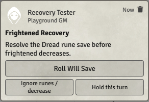

# PF2e Frightened Recovery

Automatically decrease frightened at the end of a creature's turn. No cross-scene scans, condition infliction or additional toolbox features.



- Normal frightened decreases by 1 and disappears at 0.
- Native active **Aura of Despair** and native auras explicitly tagged **dirge-of-doom** preserve frightened 1. Locked parent-granted conditions are preserved.
- Detects lesser, moderate and greater **Dread armor runes** on equipped/invested armor. Frightened enemies within 30 feet that can see the wearer receive a native Will save before recovery is resolved. Failed lesser/moderate saves set minimum 1/2; failed greater saves prevent the decrease entirely.
- The GM's actor-sheet **Frightened** header button configures a minimum or holds recovery for special effects. Pending save cards offer **Ignore runes / decrease** and **Hold this turn** overrides.
- Native save checks preserve fear/mental/emotion/visual context and PF2e's DC and result visibility settings. No automatic conditions are inflicted on save results other than the requested frightened recovery.

When NPC sight is disabled or visibility cannot be established, a GM-only card asks for adjudication. It does not silently assume blindness. A save cancellation leaves recovery pending; the GM can resolve it later. Turn advancement never waits for a save.

## Installation

Foundry Setup → Add-on Modules → Install Module, using:

```text
https://github.com/jjthibau/pf2e-frightened-recovery/releases/latest/download/module.json
```

Enable **PF2e Frightened Recovery** in Manage Modules. Tested target: Foundry 14.369 / PF2e 8.6.0. No dependencies. The module pauses automatic turn handling if PF2e Workbench is active to avoid double recovery.

## Limits

This is not a universal fear-source parser. Custom abilities and Antagonize-style ending requirements use the GM override. Dirge must already have an active native aura from your effect setup; merely owning or posting the spell does not activate it. Multiple unresolved turns are not accumulated: resolve a pending rune save before the next recovery. If frightened changes while a save is pending, that card asks the GM to resolve manually rather than overwriting the change. Encounter rewinds do not undo recovery automatically; adjust the condition manually. These controls support table adjudication without tracking unrelated actions or resources.

MIT licensed community module; not an official Paizo or Foundry VTT product. [Testing](docs/testing.md), [contributing](CONTRIBUTING.md), and [issues](https://github.com/jjthibau/pf2e-frightened-recovery/issues).
